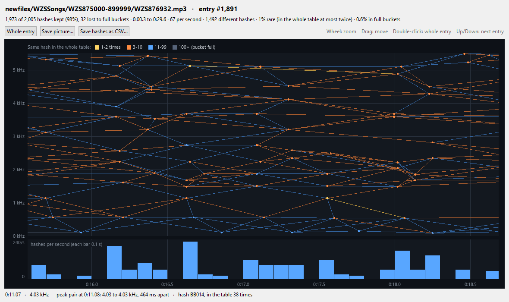
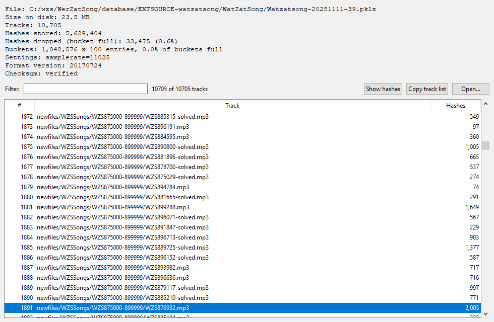

# PKLZ Viewer

A small Windows tool for looking inside the audfprint `.pklz` fingerprint
databases that [WerZatSong](https://github.com/Nel80s/WerZatSong) searches.



## What it shows

- **The table:** size, number of tracks, hashes stored and dropped, how full
  the buckets are, the settings, and whether the checksum was verified.
- **The tracks:** every entry with its hash count. You can filter, sort, and
  copy the list.
- **Where each track came from:** the Source column links an entry to its
  source when its name or the table's name says what that is.
  - Exact: a YouTube video (an id in the name), a WatZatSong post, a
    SoundCloud track, a Wayback capture.
  - Otherwise the channel or collection it came from, or a search on the
    right site (Bandcamp, archive.org).
  - **Open source** or the right-click menu opens it. The right-click menu can
    also copy the link or the name.
- **The hashes of one entry:** select an entry and click **Show hashes**, or
  double-click it. Each hash is a pair of peaks in the song's spectrogram. It
  is drawn as a line from the first peak to the second, with time across and
  frequency up. Colour shows how often the same hash occurs in the whole table:
  rare hashes (yellow) are what make an entry findable. Underneath is how many
  hashes each second of the entry has.
  - Wheel zooms, dragging moves, and a double-click shows the whole entry.
  - Up/Down goes to the next entry.
  - Hovering over a peak pair shows its frequencies, its hash and its count.
  - **Save picture…** saves a PNG; **Save hashes as CSV…** saves every hash.



## Requirements

- Windows with Python 3 (tested with 3.13), numpy and Pillow.
- A WerZatSong checkout. The viewer opens files with its loader
  (`libs/audfprint/hash_table.py`), which only lets hash-table data through.
  A `.pklz` is a pickle, and a plain `pickle.load()` of a downloaded file could
  run code. The viewer looks for WerZatSong in `C:\wzs\WerZatSong`; to use
  another folder, set the `WZS_DIR` environment variable.

Nothing is ever written to a `.pklz` file.

## Usage

```
pythonw pklz_viewer.pyw <file.pklz>                 open the window on a file
pythonw pklz_viewer.pyw                             open the window and pick a file
python  pklz_viewer.pyw --check <file...>           one summary line per file, no window
python  pklz_viewer.pyw --hashes <file> <entry #|biggest> [picture.png]
                                                    one entry's hashes in figures (and a picture)
python  pklz_viewer.pyw --sources <file...>         every entry's source link
python  pklz_viewer.pyw --register                  add it to Explorer's "Open with" for .pklz
python  pklz_viewer.pyw --unregister                take it out again
```

`--selftest <file>` and `--selftest-hashes <file> [screenshot.png]` open the
windows, try them out, and close them again.

## Good to know

- The first **Show hashes** for a file reads all its hashes once. That takes
  a few seconds for a large table; after that, every entry shows at once.
- With the usual settings, audfprint keeps times modulo 16,384 frames
  (6:20.4). An entry longer than that is folded back onto the start, and the
  window says so.
- If more than 15,000 peak pairs are on screen, only the first peaks are drawn.
  Zoom in to see the pairs.
